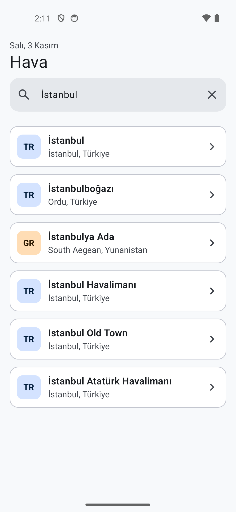
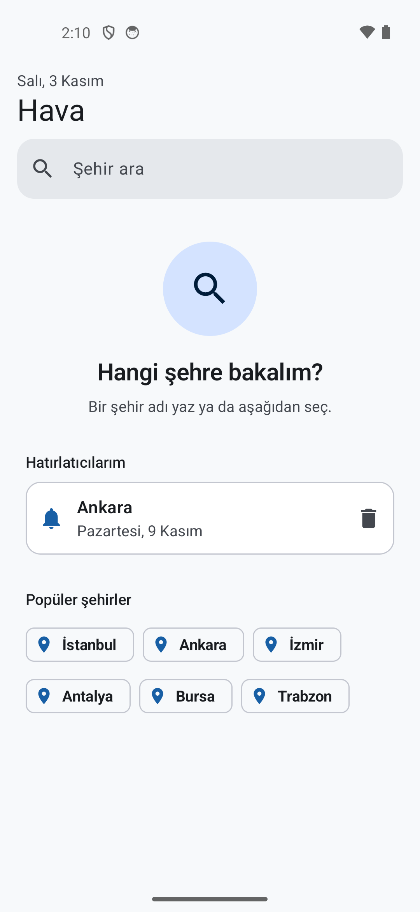
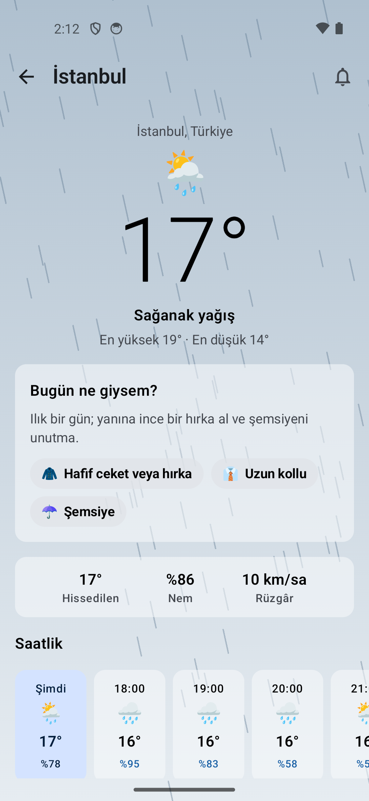
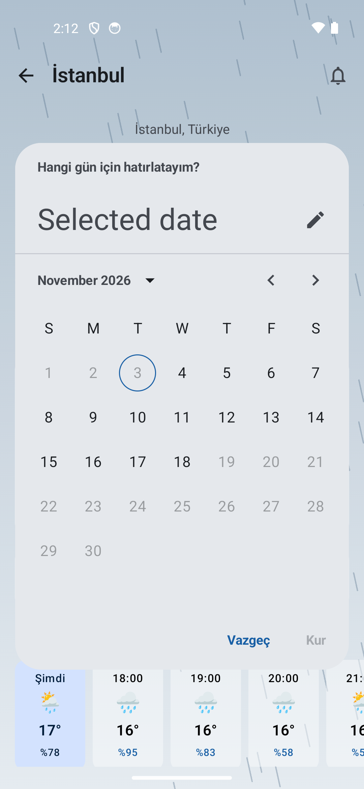

# Hava

Hava — Kotlin ve Jetpack Compose ile geliştirilmiş Android hava durumu uygulaması.

Bu proje, KAMP+ Bilişim Kampı (T.C. Gençlik ve Spor Bakanlığı & Turkcell Geleceği Yazanlar) Android
programında geliştirilen [referans projenin](https://github.com/tc-yusufburakdemir/weather-app) üzerine
kendi özelliklerimi ekleyerek geliştirdiğim bir uygulamadır.

## Ekran görüntüleri

<table>
  <tr>
    <td align="center"><br />Arama</td>
    <td align="center"><br />Tahmin</td>
    <td align="center"><br />Yağmurlu hava</td>
  </tr>
  <tr>
    <td align="center"><br />Hatırlatıcı</td>
    <td align="center"><br />Hava efektleri</td>
    <td></td>
  </tr>
</table>

## Özellikler

### Kamp projesinden gelen temel

- **Şehir arama:** Open-Meteo Geocoding API ile Türkçe şehir sonuçları.
- **Anlık, saatlik ve 7 günlük tahmin:** WMO hava kodları emoji ve Türkçe etikete çevrilir.
- **Dört UI durumu:** Yükleniyor (Shimmer), sonuç, boş sonuç ve "Tekrar dene" düğmeli hata; `sealed` bir `LoadState` ile hiçbiri atlanamaz.
- **Testler:** JSON eşlemesi, sütun→satır çevrimi, hava kodu eşlemesi ve iki ViewModel için JVM birim testleri.
- **CI:** Her pull request'te ve `main`'e push'ta GitHub Actions ktlint (Spotless) kontrolü, birim testleri ve debug derlemesi çalıştırır.
- **Release derlemesi:** R8 küçültme ve `keystore.properties` ile imzalama.
- **Checkpoint'ler:** `cp1`–`cp4` dalları projenin adım adım gelişimini gösterir ([docs/GIT-HISTORY.md](docs/GIT-HISTORY.md)).

### Benim eklediklerim

**Arama**

- **Canlı arama:** Yazmayı bıraktıktan 400 ms sonra otomatik arama yapılır (debounce); en az 2 harf gerekir ve süren eski istek iptal edilir.
- **Yeni arama ekranı:** Boş açılır ve "Hangi şehre bakalım?" karşılama görünümünü gösterir; kutu temizlenince süren arama iptal edilir.
- **Popüler şehirler:** İstanbul, Ankara, İzmir, Antalya, Bursa ve Trabzon çiplerine dokununca arama beklemeden yapılır.
- **Yenilenen üst kısım ve şehir kartları:** Türkçe tarihli büyük başlık, dolgulu arama kutusu ve yurt dışı sonuçları farklı renkte gösteren ülke rozetleri; alt başlıkta "Türkiye Cumhuriyeti" yerine "Türkiye" yazar.

**Görünüm**

- **Yeni renk paleti:** Mavi-gri tonlar; açık ve koyu temada `surfaceContainer` dahil bütün renk rolleri tanımlı.
- **Dinamik arka plan:** Tahmin ekranının arka planı hava durumuna göre yumuşak geçişli bir gradyandır.
- **Hava efektleri:** Güneş ışınları, süzülen bulutlar, eğik yağmur, salınan kar ve çift çakan şimşek Canvas ile çizilir; sistemde animasyonlar kapalıysa gösterilmez.

**Tahmin ekranı**

- **Yeni tahmin ekranı:** Ortalanmış büyük sıcaklık, bugünün en yüksek ve en düşük değeri, arka planı gösteren yarı saydam kartlar ve vurgulu "Şimdi" kartı.
- **Sıcaklık çubukları:** Her gün, haftalık ölçekte en düşükten en yükseğe uzanan, soğuktan sıcağa renklenen bir çubukla gösterilir.
- **Aşağı çekip yenileme:** Yenileme sırasında mevcut veri ekranda kalır; başarısız olursa eski veri korunur ve Snackbar ile bilgi verilir.
- **Kıyafet önerisi:** "Bugün ne giysem?" kartı; günün sıcaklığı, hissedilen sıcaklık, yağış, kar, rüzgâr ve UV indeksine bakan kural tabanlı bir motorla (`OutfitAdvisor`) öneri ve kısa bir özet üretir.
- **Saat dilimi düzeltmesi:** Saatlik liste, "Şimdi" kartı ve "Bugün" telefonun değil şehrin yerel saatine göre belirlenir.

**Hava hatırlatıcısı**

- **Hatırlatıcı kurma:** Tahmin ekranındaki zilden yarından itibaren 15 gün içinde bir tarih seçilir; Android 13 ve üstünde bildirim izni istenir.
- **Günlük kontrol:** WorkManager ile günde bir 16 günlük tahmin kontrol edilir; hava türü, en yüksek/en düşük sıcaklık (3°) veya yağış olasılığı (20 puan) değişirse bildirim gönderilir.
- **Akşam özeti:** Hedef günden önceki akşam 20:00'de "Yarın Ankara'da 14°, yağmurlu." biçiminde, kıyafet önerisini de içeren bir bildirim gelir.
- **Hatırlatıcılarım:** Kurulu hatırlatıcılar DataStore'da saklanır, arama ekranında listelenir ve silinebilir; bildirime ya da satıra dokununca o şehrin tahmini açılır.
- **Debug kısayolu:** Debug derlemesinde zile uzun basınca kontrol ve akşam özeti beklemeden çalışır.

## Kullanılan teknolojiler

Kotlin · Jetpack Compose · Material 3 · MVVM · StateFlow · Coroutines · Retrofit · Gson · Navigation Compose · WorkManager · DataStore · Open-Meteo API

## Mimari

Uygulama tek modül ve üç katmandan oluşur. `model/` veri modellerini ve kuralları içerir; saf Kotlin'dir ve
Android'e bağlı değildir. `data/` Retrofit servislerini, DataStore'u ve bunları saklayan repository'leri
içerir; her repository bir arayüzdür, testlerde sahtesi verilir. `ui/` Compose ekranlarını ve state'i
`StateFlow` ile tutan ViewModel'leri içerir. `reminder/` paketi arka planda çalışan hatırlatıcı işlerini
aynı repository'ler üzerinden yürütür.

```
com.kampplus.hava
├── MainActivity.kt              Tek Activity; bildirimden gelen şehri açar
├── data/
│   ├── ApiClient.kt             Retrofit kurulumu
│   ├── CityApi.kt               Şehir arama servisi
│   ├── CityRepository.kt
│   ├── ForecastApi.kt           Tahmin servisi (7 veya 16 gün)
│   ├── ForecastResponse.kt      Sütun → satır çevrimi
│   ├── ReminderRepository.kt    Hatırlatıcılar (DataStore + Gson)
│   └── WeatherRepository.kt
├── model/
│   ├── City.kt
│   ├── Forecast.kt              Tahmin modelleri, şehrin saatine göre "şu an" ve "bugün"
│   ├── ForecastChangeDetector.kt
│   ├── OutfitAdvisor.kt
│   ├── ReminderMessages.kt
│   ├── TurkishText.kt           Gün adları, bulunma eki ("Ankara'da")
│   ├── WeatherCondition.kt      WMO kodu → emoji ve etiket
│   └── WeatherReminder.kt
├── reminder/
│   ├── ReminderChecker.kt       Arka plan işlerinin kararları
│   ├── ReminderNotifier.kt      Bildirim kanalı ve bildirimler
│   ├── ReminderScheduler.kt     WorkManager planlaması
│   ├── ReminderService.kt       Kayıt + planlama
│   └── ReminderWorkers.kt       Günlük kontrol ve akşam özeti işleri
└── ui/
    ├── ForecastDeepLink.kt
    ├── HavaNavHost.kt
    ├── LoadState.kt
    ├── city/                    CityCard, CityScreen, CityViewModel, WelcomeView
    ├── component/               EmptyView, ErrorView, ShimmerList
    ├── forecast/                ForecastScreen, ForecastViewModel, OutfitCard, ReminderBell,
    │                            WeatherBackground, WeatherEffects
    └── theme/                   Color, Theme, Type
```

Veri akışı, durumlar, hata yönetimi ve hatırlatıcı işlerinin ayrıntıları: [docs/ARCHITECTURE.md](docs/ARCHITECTURE.md)

## Kurulum ve çalıştırma

```bash
git clone https://github.com/beyzarslann/weather-app.git
```

Projeyi Android Studio'da açın, Gradle senkronizasyonu bittikten sonra bir emülatör ya da cihazda çalıştırın.
Uygulama Android 8.0 (API 26) ve üstünü destekler.

Komut satırından:

```bash
./gradlew assembleDebug        # debug APK
./gradlew testDebugUnitTest    # birim testleri
./gradlew spotlessCheck        # ktlint biçim kontrolü
```

Windows'ta `./gradlew` yerine `gradlew.bat` kullanın.

API anahtarı gerekmez: Open-Meteo ücretsizdir ve anahtar istemez.

## Testler

Testler JVM üzerinde, emülatör olmadan çalışır. Ağ istekleri MockWebServer ile, zaman `kotlinx-coroutines-test` ile taklit edilir.

| Test | Koruduğu davranış |
|---|---|
| `CityApiTest` | Şehir JSON'unun modele eşlenmesi, eksik alanlar, istek parametreleri |
| `ForecastApiTest` | Sütun → satır çevrimi, UV ve rüzgâr alanları, varsayılan 7 günlük istek |
| `ReminderRepositoryTest` | Hatırlatıcıların DataStore'a yazılıp okunması, silme, bozuk JSON |
| `CityTest` | Alt başlıkta "Türkiye" gösterimi |
| `WeatherConditionTest` | WMO kodlarının emoji ve etikete eşlenmesi |
| `OutfitAdvisorTest` | Sıcaklık bantları ve sınır değerleri, hissedilen sıcaklık, yağış, kar, rüzgâr, UV, özet cümlesi |
| `ForecastChangeDetectorTest` | "Tahmin değişti" eşikleri ve sınır değerleri, bildirim metni |
| `ForecastTimeTest` | Saatlik listenin ve "bugün"ün şehrin saatine göre seçilmesi |
| `ReminderDateRangeTest` | Seçilebilir tarih aralığı (yarından itibaren 15 gün) |
| `ReminderMessagesTest` | Akşam özeti metni |
| `TurkishTextTest` | Bulunma eki ve Türkçe tarih biçimi |
| `ReminderCheckerTest` | İlk kontrolde bildirim olmaması, değişimde bildirim, ağ hatasında yeniden deneme, süresi geçen kayıtlar |
| `ReminderServiceTest` | Kayıtla birlikte işlerin planlanması ve iptali, akşam özetinin zamanı |
| `CityViewModelTest` | Arama durumları, debounce, boş kutu, popüler şehir çipleri, hatırlatıcı listesi |
| `ForecastViewModelTest` | Tahmin durumları, yenilemede verinin korunması, hatırlatıcı kurma |

## Teşekkür

KAMP+ Bilişim Kampı'ndaki eğitmenlerime, bu projeyi geliştirirken verdikleri destek ve rehberlik için teşekkür ederim.
